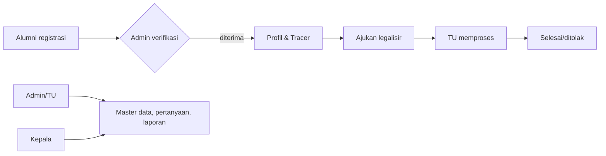
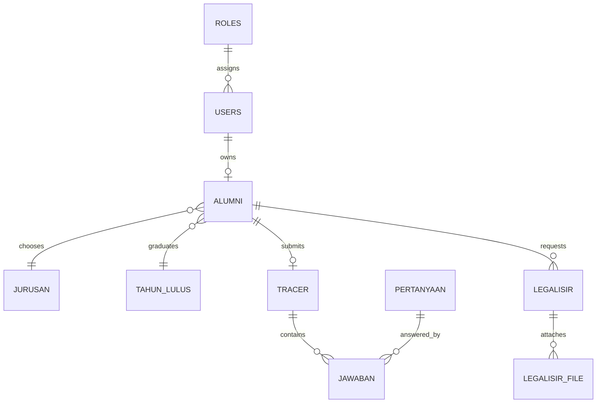

# Sistem Informasi Alumni & Tracer Study — MAN 1 Magelang

## Instalasi

1. Buat database dengan impor `database/manstudy.sql` melalui phpMyAdmin.
2. Sesuaikan kredensial MySQL di `application/config/database.php`.
3. Buka `http://localhost/ManStudy/`. Akun awal: `admin` / `password` (segera ganti di produksi).
4. Pastikan folder `uploads/legalisir` dapat ditulis web server.

## Analisis & sitemap

Empat aktor: Super Admin (pengelolaan penuh), Tata Usaha (operasional/verifikasi), Kepala Madrasah (baca laporan), dan Alumni (profil, tracer, legalisir). Alur utama: registrasi → verifikasi TU/Admin → alumni melengkapi profil → mengisi tracer dinamis → mengajukan legalisir → TU memproses → laporan statistik.

## Struktur dan keamanan

MVC CI3: controller per modul, model autentikasi/CRUD, layout Bootstrap 5 dengan gaya AdminLTE. Semua formulir memakai CSRF CI3 dan validasi server. Kata sandi memakai `password_hash`, query memakai Query Builder, serta akses kontrol berbasis peran melalui `MY_Controller`.
