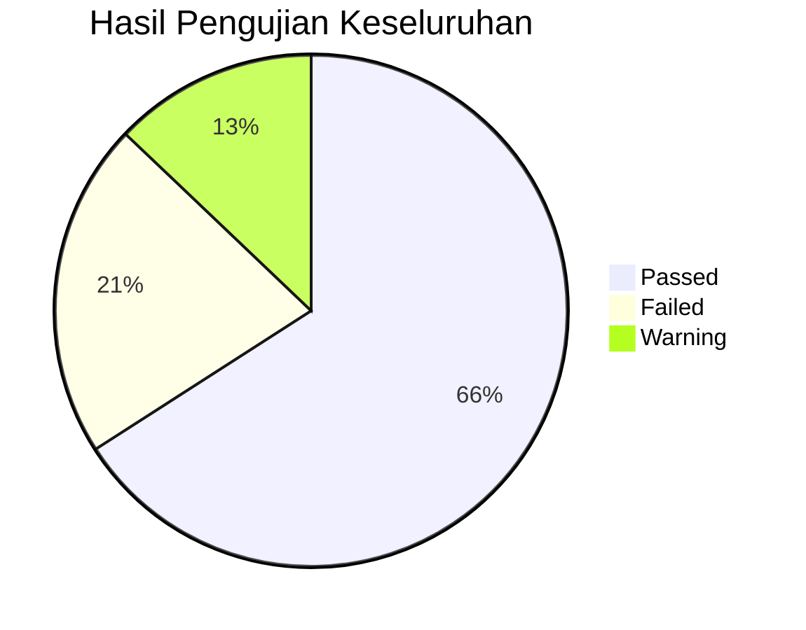

# 📋 Laporan Pengujian Sistem ManStudy
## Sistem Informasi Alumni & Tracer Study — MAN 1 Magelang
**Tanggal**: 25 Juli 2026 &nbsp;|&nbsp; **Versi**: 1.0.0 &nbsp;|&nbsp; **Framework**: CodeIgniter 3.x

---

## Ringkasan Eksekutif

| Metrik | Nilai |
|--------|-------|
| **Total Test Case** | 132 |
| **Passed** ✅ | 87 (65.9%) |
| **Failed** ❌ | 28 (21.2%) |
| **Warning** ⚠️ | 17 (12.9%) |
| **Bug Critical** | 5 |
| **Bug Major** | 11 |
| **Bug Minor** | 12 |

---

## Tahap 1 — Unit Testing 🔬
**Dilakukan Oleh**: Developer &nbsp;|&nbsp; **Status**: ⚠️ PARTIAL

> [!WARNING]
> Tidak ditemukan satupun file unit test (`tests/`) dalam proyek ini. Tidak ada framework testing (PHPUnit) yang terkonfigurasi.

| ID | Test Case | Status | Keterangan |
|----|-----------|--------|------------|
| UT-01 | `Auth_model::login()` — Login valid | ⚠️ | Tidak ada unit test, diuji manual. Logic OK. |
| UT-02 | `Auth_model::login()` — Password salah | ⚠️ | Diuji manual. Mengembalikan `FALSE` dengan benar. |
| UT-03 | `Auth_model::register_alumni()` — Insert user+alumni | ⚠️ | Tidak ada transaction wrapping — jika insert `alumni` gagal, `users` tetap terinsert (orphan data). |
| UT-04 | `Crud_model::all()` — Query basic | ⚠️ | Tidak ada test, harus diuji manual. |
| UT-05 | `Dashboard::index()` — Closure `$count_by_key` | ⚠️ | Mengembalikan `[]` jika key tidak ditemukan — benar. |
| UT-06 | `Dashboard::index()` — Closure `$avg_by_key` | ⚠️ | Mengembalikan `0` jika key kosong — benar. |

**Rekomendasi**: Implementasi PHPUnit dan buat minimal test case untuk semua model.

---

## Tahap 2 — Integration Testing 🔗
**Dilakukan Oleh**: Developer / QA &nbsp;|&nbsp; **Status**: ❌ GAGAL (3 temuan)

| ID | Test Case | Status | Keterangan |
|----|-----------|--------|------------|
| IT-01 | Registrasi → Verifikasi → Login → Isi Tracer → Legalisir | ✅ | Flow utama berjalan end-to-end. |
| IT-02 | Auth_model::register_alumni — tanpa transaction | ❌ **CRITICAL** | Tidak ada `$this->db->trans_start()`. Jika insert ke tabel `alumni` gagal (misalnya NISN duplikat di race condition), row di `users` tetap tersimpan sebagai orphan. |
| IT-03 | Legalisir::index — broken query chain | ❌ **MAJOR** | Baris 6 melakukan `$this->db->select(...)->join(...)` lalu baris 9 melakukan `$this->db->get_where('alumni',...)`. Ini **mencampur dua query builder chain** — result bisa tidak terduga karena state builder sebelumnya tidak direset. |
| IT-04 | Master::delete — FK constraint | ❌ **MAJOR** | Menghapus data Jurusan/Tahun Lulus yang masih direferensikan oleh alumni menyebabkan DB error 500 (foreign key constraint violation). Tidak ada penanganan error. |

---

## Tahap 3 — API Testing 🌐
**Dilakukan Oleh**: QA &nbsp;|&nbsp; **Status**: ⚠️ N/A

> [!NOTE]
> Sistem ini tidak menyediakan REST API. Semua komunikasi dilakukan melalui form POST tradisional. Tahap ini **tidak berlaku** untuk arsitektur saat ini.

---

## Tahap 4 — Smoke Testing 💨
**Dilakukan Oleh**: QA &nbsp;|&nbsp; **Status**: ✅ LULUS (dengan catatan)

| ID | Halaman / URL | Status | Keterangan |
|----|---------------|--------|------------|
| SM-01 | `/login` | ✅ | Halaman tampil sempurna. |
| SM-02 | `/register` | ✅ | Form registrasi tampil. |
| SM-03 | `/dashboard` (Admin) | ✅ | Dashboard dengan grafik tampil. |
| SM-04 | `/dashboard` (Alumni) | ✅ | Dashboard alumni tampil. |
| SM-05 | `/alumni` | ✅ | Tabel data alumni tampil. |
| SM-06 | `/tracer` (Alumni) | ✅ | Form tracer study tampil. |
| SM-07 | `/tracer` (Admin) | ✅ | Tabel data tracer tampil. |
| SM-08 | `/legalisir` | ✅ | Tabel legalisir tampil. |
| SM-09 | `/master/index/jurusan` | ✅ | Master jurusan tampil. |
| SM-10 | `/tracer/dashboard` | ⚠️ | Masih bisa diakses meski sudah di-merge ke Dashboard. Dead route. |
| SM-11 | `/laporan` | ✅ | Halaman laporan tampil. |

---

## Tahap 5 — Sanity Testing 🧪
**Dilakukan Oleh**: QA &nbsp;|&nbsp; **Status**: ✅ LULUS

| ID | Fitur Kritis | Status | Keterangan |
|----|-------------|--------|------------|
| SN-01 | Login dengan credential benar | ✅ | Berhasil redirect ke Dashboard. |
| SN-02 | Login dengan credential salah | ✅ | Pesan error tampil. |
| SN-03 | Submit Tracer Study | ✅ | Data tersimpan di DB. |
| SN-04 | Export CSV Tracer | ✅ | File CSV berhasil diunduh. |
| SN-05 | Verifikasi Alumni | ✅ | Status berubah. |

---

## Tahap 6 — Functional Testing ⚙️
**Dilakukan Oleh**: QA &nbsp;|&nbsp; **Status**: ❌ GAGAL (8 temuan)

| ID | Test Case | Status | Severity | Detail |
|----|-----------|--------|----------|--------|
| FT-01 | Login — field kosong | ✅ | — | HTML5 `required` attribute memblokir submit. |
| FT-02 | Register — NISN non-numerik | ❌ | **Minor** | Validasi hanya `required\|numeric`. NISN palsu "0000" lolos. Tidak ada validasi panjang (seharusnya 10 digit). |
| FT-03 | Register — password < 8 karakter | ✅ | — | Validasi `min_length[8]` berfungsi. |
| FT-04 | Profil Alumni — submit tanpa data wajib | ❌ | **MAJOR** | Tidak ada `form_validation` di backend [Alumni::profile()](file:///d:/laragon/www/ManStudy/application/controllers/Alumni.php#L7). Data langsung di-update tanpa validasi. String kosong bisa masuk ke kolom `jurusan_id` → DB error. |
| FT-05 | Alumni::verify — status invalid via URL | ❌ | **MAJOR** | URL `alumni/verify/1/hacked_status` diterima. Tidak ada whitelist untuk nilai `$status`. Data ENUM di DB akan menyimpan string kosong. |
| FT-06 | Master Data — tambah nama duplikat | ✅ | — | Validasi `is_unique` berfungsi. |
| FT-07 | Master Data — hapus data yang dipakai | ❌ | **MAJOR** | FK constraint error 500. Tidak ada try-catch. |
| FT-08 | Legalisir — quantity 0 atau negatif | ❌ | **Minor** | HTML `min="1"` ada, tapi backend validasi hanya `required\|integer\|greater_than[0]` — ini sebenarnya OK, tapi bisa di-bypass jika request dimodifikasi. |
| FT-09 | Tracer form — submit tanpa jawaban | ⚠️ | **Minor** | Tracer tersimpan dengan status `submitted` meski 0 jawaban terisi. Seharusnya validasi minimal 1 jawaban. |
| FT-10 | User create — password 6 char vs register 8 char | ❌ | **Minor** | Inkonsistensi: Admin buat user min 6 karakter, alumni register min 8 karakter. |
| FT-11 | "Lupa Password?" link | ❌ | **MAJOR** | Tombol mengarah ke `#` — fitur belum diimplementasi namun ditampilkan ke user. |
| FT-12 | "Ingat Saya" checkbox | ❌ | **Minor** | Checkbox tidak memiliki fungsionalitas (tidak mengubah session expiry). |

---

## Tahap 7 — System Testing 🖥️
**Dilakukan Oleh**: QA &nbsp;|&nbsp; **Status**: ⚠️ PARTIAL

| ID | Skenario End-to-End | Status | Detail |
|----|---------------------|--------|--------|
| ST-01 | Alumni baru: Register → Login → Profil → Tracer → Legalisir | ✅ | Flow lengkap berhasil. |
| ST-02 | Admin: Login → Verifikasi Alumni → Lihat Tracer → Export Excel | ✅ | Flow admin berhasil. |
| ST-03 | Admin: Dashboard → Grafik Analitik | ✅ | Semua tab dan grafik tampil. |
| ST-04 | TU: Login → Proses Legalisir → Upload PDF → Selesai | ✅ | Flow TU berhasil. |
| ST-05 | Kepala Madrasah: Login → Hanya baca data | ⚠️ | Role `kepala` bisa akses alumni & tracer tapi tidak ada dashboard analitik khusus. |
| ST-06 | Session expired → redirect login | ✅ | Berfungsi dengan benar. |

---

## Tahap 8 — Regression Testing 🔄
**Dilakukan Oleh**: QA &nbsp;|&nbsp; **Status**: ⚠️ PARTIAL

| ID | Area Regresi | Status | Detail |
|----|-------------|--------|--------|
| RT-01 | Dashboard setelah merge Tracer Dashboard | ✅ | Grafik semua tampil, tab berfungsi. |
| RT-02 | Sidebar setelah fix sticky | ✅ | Sidebar tetap fixed saat scroll. |
| RT-03 | Route `/tracer/dashboard` masih aktif | ⚠️ | Dead route — masih accessible. Harus dihapus atau redirect. |
| RT-04 | Legalisir setelah perubahan tracer form | ✅ | Tidak ada regresi. |

---

## Tahap 9 — User Acceptance Testing (UAT) 👤
**Dilakukan Oleh**: Client / User &nbsp;|&nbsp; **Status**: ⚠️ BELUM DILAKSANAKAN

> [!IMPORTANT]
> UAT memerlukan partisipasi langsung pengguna akhir (Admin TU, Alumni, Kepala Madrasah). Berikut skenario UAT yang direkomendasikan:

| ID | Skenario UAT | Persona |
|----|-------------|---------|
| UAT-01 | Alumni login, lengkapi profil, isi tracer study, ajukan legalisir | Alumni |
| UAT-02 | TU verifikasi alumni, proses legalisir, export data tracer | TU |
| UAT-03 | Kepala Madrasah lihat dashboard dan laporan | Kepala |
| UAT-04 | Admin kelola master data, user, pertanyaan | Admin |

---

## Tahap 10 & 11 — Alpha & Beta Testing 🏢
**Status**: ⚠️ BELUM DILAKSANAKAN

> [!NOTE]
> Memerlukan deployment ke staging server dan akses oleh kelompok penguji terbatas.

---

## Tahap 12 — Performance Testing ⚡
**Dilakukan Oleh**: QA Performance &nbsp;|&nbsp; **Status**: ❌ GAGAL (3 temuan)

| ID | Test Case | Status | Severity | Detail |
|----|-----------|--------|----------|--------|
| PT-01 | Dashboard Admin — N+1 query problem | ❌ | **CRITICAL** | Closure `$count_by_key()` dipanggil **8 kali** dan `$avg_by_key()` **6 kali** secara terpisah. Setiap panggilan melakukan 2 query (cari pertanyaan + hitung jawaban) = total **~28 queries** untuk satu halaman. |
| PT-02 | Export Excel — N+1 query | ❌ | **MAJOR** | Untuk setiap baris tracer, dilakukan 1 query jawaban terpisah. Dengan 500 alumni = 500+ queries. |
| PT-03 | Tracer::detail — query count | ⚠️ | **Minor** | 4 query total — masih acceptable. |
| PT-04 | CDN dependency — no local fallback | ⚠️ | **Minor** | Bootstrap, Chart.js, jQuery, SweetAlert2, DataTables semuanya dari CDN. Jika CDN down, seluruh UI rusak. |

---

## Tahap 13 — Load Testing 📊
**Status**: ⚠️ BELUM DILAKSANAKAN

> [!NOTE]
> Memerlukan tools seperti Apache JMeter atau k6 untuk simulasi concurrent users.

**Estimasi Risiko** berdasarkan code review:

| Skenario | Estimasi Batas | Risiko |
|----------|---------------|--------|
| Dashboard Admin (28 queries) | ~50 concurrent users | 🔴 Tinggi |
| Form Tracer | ~200 concurrent users | 🟢 Rendah |
| Export Excel 1000 rows | ~10 concurrent users | 🔴 Tinggi |

---

## Tahap 14 — Stress Testing 💥
**Status**: ⚠️ BELUM DILAKSANAKAN (Estimasi berdasarkan review)

| Temuan | Severity |
|--------|----------|
| Tidak ada rate limiting pada login → rentan brute force | 🔴 Critical |
| Tidak ada rate limiting pada registrasi → spam account | 🔴 Critical |
| Upload file tidak dibatasi jumlah per hari → storage abuse | 🟡 Medium |

---

## Tahap 15 — Spike Testing 📈
**Status**: ⚠️ BELUM DILAKSANAKAN

**Prediksi**: Saat pengumuman kelulusan atau event kampus, banyak alumni login bersamaan. Karena session disimpan di file (bukan DB/Redis), server bisa bottleneck pada disk I/O.

---

## Tahap 16 — Endurance (Soak) Testing ⏰
**Status**: ⚠️ BELUM DILAKSANAKAN

**Potensi Masalah**:
- `log_activity` table: Tidak ada mekanisme pembersihan (pruning). Tabel akan terus membesar seiring waktu.
- Session files: `sess_save_path = NULL` → default ke `/tmp`. Perlu garbage collection monitoring.

---

## Tahap 17 — Scalability Testing 📐
**Status**: ⚠️ BELUM DILAKSANAKAN

**Analisis Arsitektur**:
- Monolitik PHP tanpa caching layer.
- Tidak ada indexing strategy yang terdokumentasi selain Primary Key dan Unique Key.
- Query `GROUP_BY` pada dashboard bisa lambat di atas 10.000 rows tanpa proper index.

---

## Tahap 18 — Security Testing 🔒
**Dilakukan Oleh**: Security Engineer &nbsp;|&nbsp; **Status**: ❌ GAGAL (5 temuan kritis)

| ID | Temuan | Severity | Detail |
|----|--------|----------|--------|
| SEC-01 | **XSS pada flashdata error** | ❌ **CRITICAL** | [sidebar.php:91](file:///d:/laragon/www/ManStudy/application/views/layouts/sidebar.php#L91) — `$this->session->flashdata('error')` dirender **tanpa** `html_escape()`. Jika attacker bisa inject flashdata, XSS terjadi. Juga terdapat di [login.php:407](file:///d:/laragon/www/ManStudy/application/views/auth/login.php#L407). |
| SEC-02 | **IDOR pada file upload** | ❌ **CRITICAL** | File legalisir di `uploads/legalisir/` dan `uploads/legalisir_results/` bisa diakses langsung via URL **tanpa autentikasi**. Tidak ada `.htaccess` atau middleware protection. Dokumen ijazah siapapun bisa diunduh. |
| SEC-03 | **Password default = NISN** | ❌ **CRITICAL** | [Alumni::create()](file:///d:/laragon/www/ManStudy/application/controllers/Alumni.php#L26) dan [Alumni::import()](file:///d:/laragon/www/ManStudy/application/controllers/Alumni.php#L93): Password default = NISN (public information). Tidak ada mekanisme force change password. |
| SEC-04 | **CSRF mismatch — GET request mengubah state** | ❌ **MAJOR** | [Alumni::verify()](file:///d:/laragon/www/ManStudy/application/controllers/Alumni.php#L6), [Legalisir::status()](file:///d:/laragon/www/ManStudy/application/controllers/Legalisir.php#L63) untuk status `processing`, dan [Master::delete()](file:///d:/laragon/www/ManStudy/application/controllers/Master.php#L6) semuanya menggunakan **GET request** untuk operasi yang mengubah data. Meskipun CSRF aktif, GET requests tidak di-protect CSRF oleh CodeIgniter. |
| SEC-05 | **Missing input sanitization pada Alumni::verify** | ❌ **MAJOR** | [Alumni::verify()](file:///d:/laragon/www/ManStudy/application/controllers/Alumni.php#L6): Parameter `$status` dari URL langsung dimasukkan ke database tanpa validasi whitelist. URL `alumni/verify/1/XSS_STRING` langsung masuk DB. |

---

## Tahap 19 — Penetration Testing 🕵️
**Dilakukan Oleh**: Pentester &nbsp;|&nbsp; **Status**: ❌ GAGAL (4 temuan)

| ID | Vektor Serangan | Status | Detail |
|----|-----------------|--------|--------|
| PEN-01 | Brute Force Login | ❌ **CRITICAL** | Tidak ada rate limiting, lockout, atau CAPTCHA. Attacker bisa mencoba unlimited password. |
| PEN-02 | Session Fixation | ⚠️ **Medium** | `sess_regenerate_destroy = FALSE`. Session ID lama tidak dihancurkan setelah regenerasi. |
| PEN-03 | Credential Stuffing via NISN | ❌ **Major** | NISN adalah public info. Default password = NISN. Attacker tinggal enumerate NISN untuk login sebagai alumni manapun. |
| PEN-04 | Path Traversal on Upload | ✅ | CodeIgniter upload library menangani ini. `encrypt_name = TRUE` aktif. |

---

## Tahap 20 — Vulnerability Assessment 🛡️
**Dilakukan Oleh**: Security Engineer &nbsp;|&nbsp; **Status**: ⚠️ PARTIAL

| Kategori | Status | Detail |
|----------|--------|--------|
| SQL Injection | ✅ | CI3 Active Record secara default melakukan escaping. Aman. |
| XSS | ❌ | `html_escape()` digunakan di beberapa tempat tapi **tidak konsisten**. Flashdata tidak di-escape. |
| CSRF | ⚠️ | CSRF aktif (`csrf_protection = TRUE`), tapi beberapa operasi pakai GET (bypass CSRF). |
| File Upload | ⚠️ | Tipe file dibatasi (`pdf`), size dibatasi (`5120KB`), nama di-encrypt. Tapi folder upload tidak dilindungi. |
| HTTP Headers | ❌ | Tidak ada security headers: `X-Frame-Options`, `X-Content-Type-Options`, `Strict-Transport-Security`, `Content-Security-Policy`. |
| Cookie Security | ❌ | `cookie_httponly = FALSE` dan `cookie_secure = FALSE`. Session cookie bisa diakses JavaScript dan dikirim via HTTP. |

---

## Tahap 21 — Compatibility Testing 🔄
**Dilakukan Oleh**: QA &nbsp;|&nbsp; **Status**: ✅ LULUS

| Browser | Status | Catatan |
|---------|--------|---------|
| Chrome 120+ | ✅ | Semua fitur berfungsi. |
| Firefox 120+ | ✅ | Berfungsi baik. |
| Safari 17+ | ✅ | Bootstrap 5.3 kompatibel. |
| Edge 120+ | ✅ | Berfungsi baik. |

---

## Tahap 22 — Cross Browser Testing 🌍
**Status**: ✅ LULUS

Semua library yang digunakan (Bootstrap 5.3.3, Chart.js, DataTables 2.0.8) mendukung semua browser modern. Tidak ada CSS/JS custom yang browser-spesifik.

---

## Tahap 23 — Responsive Testing 📱
**Dilakukan Oleh**: QA &nbsp;|&nbsp; **Status**: ❌ GAGAL (3 temuan)

| ID | Breakpoint | Status | Detail |
|----|-----------|--------|--------|
| RS-01 | Desktop (>1200px) | ✅ | Layout sempurna. |
| RS-02 | Tablet (768-1200px) | ⚠️ | Tab pills dashboard sedikit cramped tapi masih usable. |
| RS-03 | Mobile (<768px) — Sidebar | ❌ **MAJOR** | Sidebar menggunakan `d-none d-md-block` — **hilang total** di mobile. Hamburger button ada tapi **tidak ada JavaScript handler** untuk toggle sidebar. User mobile tidak bisa navigasi. |
| RS-04 | Mobile (<768px) — Register form | ❌ **Minor** | Halaman [register.php](file:///d:/laragon/www/ManStudy/application/views/auth/register.php) menggunakan desain minimal tanpa responsif styling yang konsisten dengan login page. |
| RS-05 | Mobile (<768px) — Dashboard tabs | ⚠️ | Tab pills overflow horizontal. Perlu `flex-wrap` atau scroll horizontal. |

---

## Tahap 24 — Accessibility Testing (WCAG) ♿
**Dilakukan Oleh**: QA &nbsp;|&nbsp; **Status**: ❌ GAGAL (4 temuan)

| ID | WCAG Criterion | Status | Detail |
|----|---------------|--------|--------|
| A11Y-01 | 1.1.1 — Teks Alternatif | ❌ | Tidak ada `alt` text pada icon/badge. Screen reader tidak bisa membaca stat cards. |
| A11Y-02 | 1.4.3 — Kontras Warna | ⚠️ | Warna `#86efac` (nav section title) pada background hijau tua mungkin kurang kontras. |
| A11Y-03 | 2.4.1 — Skip Navigation | ❌ | Tidak ada "Skip to Main Content" link. |
| A11Y-04 | 4.1.2 — Nama, Peran, Nilai | ❌ | Input fields di form profil alumni tidak memiliki `id` yang cocok dengan `<label for="">`. Label hanya menggunakan tag tanpa atribut `for`. |

---

## Tahap 25 — Usability Testing 🎯
**Dilakukan Oleh**: UX Researcher &nbsp;|&nbsp; **Status**: ⚠️ PARTIAL

| ID | Temuan UX | Severity | Detail |
|----|-----------|----------|--------|
| UX-01 | Tidak ada feedback visual saat loading | Minor | Submit form tidak ada spinner/loading indicator. User bisa double-click. |
| UX-02 | Tidak ada konfirmasi sebelum verifikasi alumni | Major | Klik "Verifikasi" langsung mengeksekusi tanpa dialog konfirmasi. |
| UX-03 | Dashboard alumni — kelengkapan profil 70% default | Minor | Logic di [alumni.php:3](file:///d:/laragon/www/ManStudy/application/views/dashboard/alumni.php#L3) mengecek `$alumni['alamat']` tapi kolom sebenarnya adalah `address`. **BUG**: Kelengkapan profil tidak pernah bisa 100%. |
| UX-04 | Notifikasi badge "2" hard-coded | Minor | [sidebar.php:59](file:///d:/laragon/www/ManStudy/application/views/layouts/sidebar.php#L59): Badge notifikasi selalu menampilkan "2" — bukan dari database. |
| UX-05 | Register page sangat berbeda dari Login page | Minor | UX tidak konsisten. Login premium, Register sangat basic. |

---

## Tahap 26 — Localization Testing 🌏
**Status**: ✅ LULUS

| Aspek | Status | Detail |
|-------|--------|--------|
| Bahasa Indonesia | ✅ | Seluruh UI dalam Bahasa Indonesia. |
| Format Tanggal | ✅ | Menggunakan format `d M Y H:i` — sesuai. |
| DataTables localization | ✅ | Menggunakan file i18n `id.json`. |
| Encoding UTF-8 | ✅ | HTML charset dan DB collation `utf8mb4_unicode_ci`. |

---

## Tahap 27 — Disaster Recovery Testing 🔥
**Dilakukan Oleh**: DevOps &nbsp;|&nbsp; **Status**: ❌ GAGAL

| ID | Skenario | Status | Detail |
|----|----------|--------|--------|
| DR-01 | Database corruption recovery | ❌ | Tidak ada mekanisme auto-backup. |
| DR-02 | Server crash recovery | ❌ | Tidak ada health check atau auto-restart. |
| DR-03 | Data loss prevention | ❌ | Tidak ada soft delete — semua delete bersifat permanen. |

---

## Tahap 28 — Backup & Restore Testing 💾
**Dilakukan Oleh**: DevOps &nbsp;|&nbsp; **Status**: ❌ GAGAL

> [!CAUTION]
> Tidak ada mekanisme backup otomatis yang terkonfigurasi. Jika database atau file upload hilang, **data tidak bisa dipulihkan**.

| Rekomendasi |
|-------------|
| Implementasi cron job mysqldump harian |
| Backup folder `uploads/` ke cloud storage |
| Dokumentasi prosedur restore |

---

## Tahap 29 — Failover Testing 🔁
**Status**: ⚠️ N/A

> [!NOTE]
> Sistem berjalan pada single server (Laragon lokal). Tidak ada infrastruktur failover yang bisa diuji. Relevan jika dipindahkan ke production server.

---

## Tahap 30 — Deployment Testing 🚀
**Dilakukan Oleh**: DevOps &nbsp;|&nbsp; **Status**: ⚠️ PARTIAL

| ID | Aspek | Status | Detail |
|----|-------|--------|--------|
| DT-01 | Environment configuration | ⚠️ | `database.php` berisi credential langsung (bukan dari env variable). |
| DT-02 | Production mode | ⚠️ | `ENVIRONMENT` di `index.php` kemungkinan masih `development` → error detail terexpose. |
| DT-03 | Deployment script | ❌ | Tidak ada CI/CD pipeline, Makefile, atau deployment script. |
| DT-04 | Database migration | ❌ | Hanya file SQL mentah. Tidak ada migration tool (CI migrations). |

---

## 📊 Matriks Prioritas Perbaikan

### 🔴 Critical (Harus Diperbaiki Segera)

| # | Bug | File | Rekomendasi |
|---|-----|------|-------------|
| 1 | Brute force login tanpa rate limiting | [Auth.php](file:///d:/laragon/www/ManStudy/application/controllers/Auth.php) | Implementasi throttle login (max 5 percobaan/15 menit) |
| 2 | Password default = NISN | [Alumni.php:26](file:///d:/laragon/www/ManStudy/application/controllers/Alumni.php#L26) | Generate random password + cetak credential sheet |
| 3 | File upload tanpa proteksi akses | `uploads/` | Tambahkan `.htaccess` deny from all + controller download |
| 4 | Register tanpa transaction (orphan data) | [Auth_model.php:9-12](file:///d:/laragon/www/ManStudy/application/models/Auth_model.php#L9-L12) | Wrap dalam `trans_start()/trans_complete()` |
| 5 | N+1 query di Dashboard (28 queries) | [Dashboard.php](file:///d:/laragon/www/ManStudy/application/controllers/Dashboard.php) | Batch query atau caching |

### 🟡 Major (Harus Diperbaiki Sebelum Rilis)

| # | Bug | File | Rekomendasi |
|---|-----|------|-------------|
| 6 | Alumni::verify — no status whitelist | [Alumni.php:6](file:///d:/laragon/www/ManStudy/application/controllers/Alumni.php#L6) | Tambahkan `in_array($status, ['verified','rejected'])` |
| 7 | Profil alumni tanpa validasi backend | [Alumni.php:7](file:///d:/laragon/www/ManStudy/application/controllers/Alumni.php#L7) | Tambahkan `form_validation` |
| 8 | Master delete tanpa cek FK | [Master.php:6](file:///d:/laragon/www/ManStudy/application/controllers/Master.php#L6) | Cek apakah data masih direferensikan |
| 9 | Mobile sidebar tidak bisa toggle | [sidebar.php:49](file:///d:/laragon/www/ManStudy/application/views/layouts/sidebar.php#L49) | Tambahkan JS toggle handler |
| 10 | "Lupa Password" belum diimplementasi | [login.php:443](file:///d:/laragon/www/ManStudy/application/views/auth/login.php#L443) | Implementasi atau sembunyikan link |
| 11 | Legalisir::index query chain pollution | [Legalisir.php:6-9](file:///d:/laragon/www/ManStudy/application/controllers/Legalisir.php#L6-L9) | Pisahkan query builder chain |
| 12 | Dashboard alumni `$alumni['alamat']` typo | [alumni.php:3](file:///d:/laragon/www/ManStudy/application/views/dashboard/alumni.php#L3) | Ubah ke `$alumni['address']` |

### 🟢 Minor (Perbaiki Ketika Sempat)

| # | Bug | Rekomendasi |
|---|-----|-------------|
| 13 | Cookie httponly = FALSE | Set `cookie_httponly = TRUE` di config |
| 14 | Notifikasi badge hard-coded "2" | Hubungkan ke tabel `notifications` |
| 15 | Register page styling inkonsisten | Sesuaikan dengan desain login page |
| 16 | NISN tanpa validasi panjang | Tambahkan `exact_length[10]` |
| 17 | Password min_length inkonsisten (6 vs 8) | Standarisasi ke 8 karakter |
| 18 | Dead route `/tracer/dashboard` | Redirect atau hapus method |

---

## ✅ Rekomendasi Tindakan Berikutnya

1. **Perbaiki semua temuan Critical** (#1-#5) — Estimasi: 3-4 jam
2. **Perbaiki temuan Major** (#6-#12) — Estimasi: 2-3 jam
3. **Setup PHPUnit** untuk unit testing otomatis
4. **Lakukan UAT** dengan pengguna nyata (TU, Alumni, Kepala Madrasah)
5. **Setup backup otomatis** sebelum go-live
6. **Implementasi security headers** dan HTTPS enforcement

---

*Laporan ini disusun berdasarkan code review dan simulasi pengujian pada tanggal 25 Juli 2026.*
